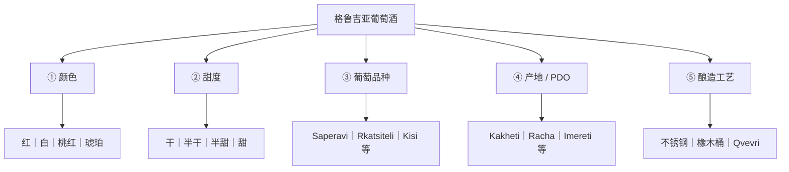

# 格鲁吉亚葡萄酒总览：分类树、历史与核心概念

> 本页是专题入口。**中文日常所谓“红酒”常泛指葡萄酒；严格来说，红葡萄酒只是葡萄酒按颜色分类的一个分支。** 本专题同时涵盖红、白、桃红与琥珀葡萄酒。

## 一句话总结

理解格鲁吉亚葡萄酒，应把 **颜色、甜度、葡萄品种、产区名称（PDO）和酿造工艺** 看成五个互相独立、可组合的分类维度，而不是混成同一种“酒的等级”。最重要的入门坐标：**Saperavi（红葡萄）、Rkatsiteli（白葡萄）、Kakheti（主产区）、Qvevri（传统陶罐）**。

## 核心知识

### 一张图：五个分类维度

> **组合例子**：Mukuzani = **红色 + 干型 + Saperavi + Mukuzani PDO + 具体酒庄的工艺**；Kindzmarauli = **红色 + 天然半甜 + Saperavi + Kindzmarauli PDO**。二者并非两种葡萄品种。
>
> **再举一例**：Qvevri（陶罐）是容器/酿造方式，琥珀葡萄酒是带皮浸渍的白葡萄酒风格；两者高度相关，但不是同义词。

### 用一张表记住主流类型

| 消费者看到的名称 | 它究竟是什么？ | 典型例子 |
|---|---|---|
| Saperavi（საფერავი） | 红葡萄**品种**；也可作为普通酒款名 | Saperavi 干红 |
| Rkatsiteli（რქაწითელი） | 白葡萄**品种** | 干白或陶罐琥珀酒 |
| Mukuzani | 有产地和生产规范的 **PDO 干红** | Saperavi，卡赫季 |
| Kindzmarauli | **PDO 天然半甜红** | Saperavi，卡赫季 |
| Khvanchkara | **PDO 天然半甜红** | Aleksandrouli + Mujuretuli，拉恰 |
| Tsinandali | **PDO 干白** | 常见 Rkatsiteli + Kakhuri Mtsvane |
| Tvishi | 著名的 **PDO 天然半甜白** | Tsolikouri，列其胡米 |
| Amber wine / 琥珀酒 | **酿造风格**，不是葡萄品种或固定甜度 | 带皮浸渍的 Rkatsiteli 或 Kisi |
| Qvevri（ქვევრი） | **陶罐和传统酿酒体系** | 可用于红葡萄酒或白葡萄酒 |

### 如何记忆

1. **颜色**回答“是什么颜色”：红／白／桃红／琥珀。
2. **甜度**回答“剩多少糖”：干／半干／半甜／甜。
3. **品种**回答“用什么葡萄”：Saperavi、Rkatsiteli、Kisi……
4. **产区**回答“葡萄从哪里来、酒能否用某个受保护名称”：Kakheti、Racha，或具体 PDO Mukuzani、Kindzmarauli……
5. **工艺**回答“怎么做”：温控发酵、不锈钢罐、橡木桶、Qvevri、是否带皮浸渍等。

### 历史坐标

- **约公元前 6000–5800 年**：格鲁吉亚新石器时代陶器发现与葡萄酒有关的生物分子残留，是目前最早的一批可靠葡萄酒考古证据之一。这不等于能够证明人类第一杯葡萄酒必然诞生于格鲁吉亚。
- **2013 年**：联合国教科文组织将格鲁吉亚传统 Qvevri 酿酒法列为非物质文化遗产。
- **今天**：传统家庭酒窖（Marani）、小酒庄和现代商业化酒厂并存。著名半甜红与干红、干白、琥珀葡萄酒共同构成葡萄酒文化。

## 从总览进入深入阅读

| 你想回答的问题 | 专题 |
|---|---|
| 哪个地方生产什么葡萄？ | [格鲁吉亚葡萄品种与产区](georgian-wine-regions-and-grapes.md) |
| 干红、半甜红、白葡萄酒、琥珀酒有什么不同？陶罐怎么酿？ | [格鲁吉亚葡萄酒风格与酿造技术](georgian-wine-vinification-and-styles.md) |
| Mukuzani 和 Kindzmarauli 的区别？如何看瓶标、选两瓶？ | [格鲁吉亚 PDO 名酒与购买指南](georgian-wine-appellations-and-buying.md) |

## 常见误区

- “格鲁吉亚酒都是甜的”——错误，既有干型也有半甜型，且有多种颜色。
- “同一葡萄只酿一种酒”——错误。Saperavi 可酿干红和半甜红。
- “陶罐 = 琥珀酒 = 有机酒 = 高级酒”——四者不能划等号。
- “同名 PDO 的所有酒庄酒质相同”——错误，PDO 规范来源和生产要求，不替代感官评价。
- “年份越老越好”——错误，储藏状态和具体酒款的陈年潜力更重要。

## 参考资料

资料核验：2026-10-27。

- McGovern 等，*Early Neolithic wine of Georgia in the South Caucasus*，PNAS (2017)：https://pmc.ncbi.nlm.nih.gov/articles/PMC5715782/
- UNESCO，*Ancient Georgian traditional Qvevri wine-making method*：https://ich.unesco.org/en/RL/ancient-georgian-traditional-qvevri-wine-making-method-00870
- 格鲁吉亚国家葡萄酒局（National Wine Agency），产区与葡萄品种：https://wine.gov.ge/En/WineMakingRegions
- 格鲁吉亚国家葡萄酒局，2025-04-08 PDO 名录变更（**当时为 32 个，不代表 2026 年实时数量**）：https://wine.gov.ge/En/News/38208

## 相关知识

- [葡萄品种与产区](georgian-wine-regions-and-grapes.md)：提供“葡萄—地域—风味”的对应关系。
- [风格与酿造技术](georgian-wine-vinification-and-styles.md)：解释为何同一种葡萄可以酿出不同颜色、甜度和口感。
- [PDO 名酒与选购](georgian-wine-appellations-and-buying.md)：将分类体系落实到具体酒瓶与购买决策。

## 导航

- [格鲁吉亚饮食文化目录](README.md)
