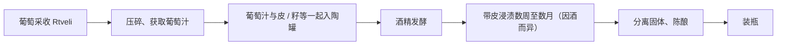

# 格鲁吉亚葡萄酒：颜色、甜度与 Qvevri 酿造工艺

## 代表图片

> **图片性质**：UNESCO 非遗项目页面的传统 Qvevri 酒窖**参考照片**，不是本次旅行拍摄的原图；以外部图片直链显示，离线 Obsidian 可能无法显示。来源：https://ich.unesco.org/en/RL/ancient-georgian-traditional-qvevri-wine-making-method-00870 （核验 2026-10-27）。未在仓库保存图片字节。

## 一句话总结

按**颜色**可分红、白、桃红、琥珀；按**甜度**可分干、半干、半甜、甜；按**工艺**可分现代容器发酵、橡木陈酿、Qvevri 等。**琥珀酒是白葡萄带皮浸渍得到的风格，Qvevri 是陶罐/酿酒法，两者相关但不等同。**

## 核心知识

### 1. 颜色分类：看原料与葡萄皮接触方式

| 类型 | 原料与方式 | 典型表现 |
|---|---|---|
| **红葡萄酒 Red** | 红葡萄，通常带皮发酵以提取颜色和单宁 | 红色/紫红色；黑色或红色水果、单宁 |
| **白葡萄酒 White** | 主要使用白葡萄，常先压榨、分离葡萄皮后发酵 | 清爽、单宁较少、柑橘或苹果等香气 |
| **桃红葡萄酒 Rosé** | 常用红葡萄，较短时间带皮接触等工艺 | 粉红色、果香、相对清爽 |
| **琥珀葡萄酒 Amber / Orange** | **白葡萄较长时间带皮接触**，常与陶罐工艺结合 | 金黄至琥珀色；干果、茶香、可能有明显单宁 |

> “Orange wine”通常不含橙子；**琥珀色 ≠ 甜酒**。干型琥珀酒很常见。

### 2. 甜度分类：由残糖和酸度共同决定体验

| 中文 | 英文 | 用于理解的常见近似残糖 |
|---|---|---|
| 干型 | Dry | 通常 ≤4 g/L；某些分级规则还考虑酸度 |
| 半干 | Semi-dry | 约 4–12 g/L |
| 半甜 | Semi-sweet | 约 12–45 g/L |
| 甜 | Sweet | 通常 >45 g/L |

以上是**方便选酒的近似范围**，不是对一切国家法规的完整抄录；同等残糖下酸度更高的酒可能显得不那么甜。

**天然半甜红怎么来？** 酿酒师利用葡萄自身含糖量，在发酵尚未把糖全部转为酒精时采用降温等手段控制/中止发酵，并通过稳定措施防止装瓶后继续发酵；“天然”强调留下原葡萄糖分，不能理解为“不经过任何技术控制”。典型例子：Kindzmarauli、Khvanchkara。

### 3. Qvevri 陶罐的技术逻辑

**Qvevri（ქვევრი）** 是传统的大型卵形陶器，通常埋入地下，用于葡萄汁发酵、浸渍、陈酿和储存。埋地有助于缓冲温度波动；陶器本身不赋予橡木桶那样的香草与烘烤木味。

常见传统**卡赫季式白葡萄**流程（其他地区可能不同）：

传统 **Imereti**（伊梅列季）带皮发酵方法通常比典型 Kakheti（卡赫季）式使用较少的固体葡萄渣、浸渍较轻；不能把两地陶罐酒当成一种完全固定的流程。

### 4. Qvevri、不锈钢、橡木桶——不是品质等级

| 容器 | 主要技术特征 | 不应得出的结论 |
|---|---|---|
| **不锈钢罐** | 易控制温度、清洁与氧气接触，适合保持清爽果香 | 不代表廉价或不传统 |
| **橡木桶** | 陈酿中可能改变氧化过程及酒体，并带来木质香气 | 橡木味越重不代表越高级 |
| **Qvevri 陶罐** | 可兼具发酵、浸渍、储存；体现在地技术传统 | 不等于天然、有机、无添加或零缺陷 |

### 5. 风格与餐桌搭配：感官框架

- **Saperavi 干红**：较有酒体和单宁，可先从约 15–18°C 饮用，适合牛羊肉、烤肉等。
- **Kindzmarauli / Khvanchkara 半甜红**：略冰镇约 10–14°C 较容易平衡甜感；适合单独品尝或配部分奶酪、食物。
- **普通干白**：常从约 8–12°C 开始。
- **干型琥珀酒**：可从约 12–15°C 开始；有时可搭配蘑菇、坚果、香草调味食物，具体因酒而异。

与 [格鲁吉亚调味体系](georgian-seasoning-and-khmeli-suneli.md) 的联系：当地核桃、香草、蒜和果酸构成许多料理的风味骨架，选酒时宜考虑酸度、单宁与食物油脂/强度的平衡，而不是只按“红酒配红肉”。

## 误区与质量判断

1. **Qvevri ≠ Amber**：红酒同样可以在陶罐中酿；琥珀酒也可以在非陶罐容器中酿。
2. **有沉淀、浑浊 ≠ 必然高级**：一些酒未过滤，但霉味、明显醋酸及其他缺陷也可能来自卫生或控制问题。
3. **半甜 ≠ 加白砂糖的干红**：经典天然半甜 PDO 主要依赖葡萄本身的糖分。
4. **干红不一定更有陈年潜力**：酒体、酸度、单宁、酿造质量和保存共同决定。
5. **“有机”“自然酒”“Qvevri”不是同义词**：需看酒庄工艺说明及认证情况。

## 参考资料

核验日期：2026-10-27。

- UNESCO，传统 Qvevri 酿酒方法与文化传承：https://ich.unesco.org/en/RL/ancient-georgian-traditional-qvevri-wine-making-method-00870
- National Wine Agency，Qvevri Wine：https://wine.gov.ge/En/KvevriWine
- National Wine Agency，各区传统酿酒技术：https://wine.gov.ge/En/WineMakingRegions
- National Wine Agency，Rkatsiteli 等白葡萄的现代与陶罐风格：https://wine.gov.ge/En/VarietyWhite
- Wineland，葡萄酒标签/残糖分类消费者指南：https://wineland.ge/academy/guides/wine-label

## 相关知识

- [葡萄酒分类总览](georgian-wine-overview.md)：五轴分类框架。
- [格鲁吉亚葡萄品种与产区](georgian-wine-regions-and-grapes.md)：不同地区的浸渍与品种风格。
- [PDO 名酒与购买指南](georgian-wine-appellations-and-buying.md)：把工艺、甜度落实到酒款。
- [格鲁吉亚调味体系](georgian-seasoning-and-khmeli-suneli.md)：葡萄酒餐食搭配的当地风味背景。

## 导航

- [格鲁吉亚饮食文化目录](README.md)
