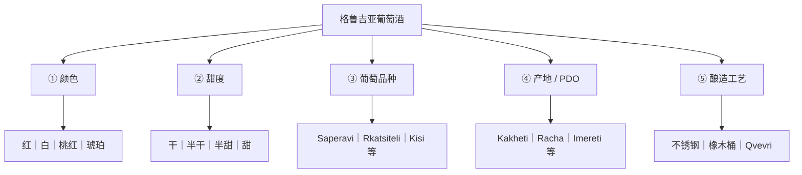
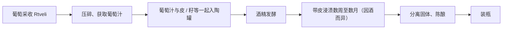

# 格鲁吉亚葡萄酒：历史、分类、产区、葡萄与酿造


> **图片来源**：[联合国教科文组织 Qvevri 酿酒法非遗项目](https://ich.unesco.org/en/RL/ancient-georgian-traditional-qvevri-wine-making-method-00870)，图片直链于 2026-10-28 核验可打开。参考图非用户实拍；仅外链，**未本地存储**，离线可能不显示。

> “红酒”在中文口语中有时泛指葡萄酒；严格说，红葡萄酒只是按颜色划分的一种。本页包括红、白、桃红和琥珀葡萄酒。

## 一句话总结

格鲁吉亚葡萄酒可以用五个彼此独立的维度理解：**颜色 × 甜度 × 葡萄品种 × 产地/PDO × 酿造工艺**。入门四个核心关键词是：**Saperavi（红葡萄）／Rkatsiteli（白葡萄）／Kakheti（核心产区）／Qvevri（陶罐酿造）**。

## 核心知识

### 1. 葡萄酒的五轴分类框架

#### 分类脑图



> **组合例子**：Mukuzani = **红色 + 干型 + Saperavi + Mukuzani PDO + 具体酒庄的工艺**；Kindzmarauli = **红色 + 天然半甜 + Saperavi + Kindzmarauli PDO**。二者并非两种葡萄品种。
>
> **再举一例**：Qvevri（陶罐）是容器/酿造方式，琥珀葡萄酒是带皮浸渍的白葡萄酒风格；两者高度相关，但不是同义词。

#### 消费者常见名称：品种、酒款还是工艺？

| 消费者看到的名称 | 它究竟是什么？ | 典型例子 |
|---|---|---|
| Saperavi（საფერავი） | 红葡萄**品种**；也可作为普通酒款名 | Saperavi 干红 |
| Rkatsiteli（რქაწითელი） | 白葡萄**品种** | 干白或陶罐琥珀酒 |
| Mukuzani | 有产地和生产规范的 **PDO 干红** | Saperavi，卡赫季 |
| Kindzmarauli | **PDO 天然半甜红** | Saperavi，卡赫季 |
| Khvanchkara | **PDO 天然半甜红** | Aleksandrouli + Mujuretuli，拉恰 |
| Tsinandali | **PDO 干白** | 常见 Rkatsiteli + Kakhuri Mtsvane |
| Tvishi | 著名的 **PDO 天然半甜白** | Tsolikouri，列其胡米 |
| Amber wine / 琥珀酒 | **酿造风格**，不是葡萄品种或固定甜度 | 带皮浸渍的 Rkatsiteli 或 Kisi |
| Qvevri（ქვევრი） | **陶罐和传统酿酒体系** | 可用于红葡萄酒或白葡萄酒 |

五轴各自回答不同的问题：**颜色**看酒液类型，**甜度**看残糖，**品种**看原料，**PDO** 看产地和法定要求，**工艺**看发酵、浸渍及陈酿过程。它们可以交叉组合，不代表等级高低。

### 2. 历史、传统与葡萄酒文化

- **约公元前 6000–5800 年**：格鲁吉亚新石器时代陶器发现与葡萄酒有关的生物分子残留，是目前最早的一批可靠葡萄酒考古证据之一。这不等于能够证明人类第一杯葡萄酒必然诞生于格鲁吉亚。
- **2013 年**：联合国教科文组织将格鲁吉亚传统 Qvevri 酿酒法列为非物质文化遗产。
- **今天**：传统家庭酒窖（Marani）、小酒庄和现代商业化酒厂并存。著名半甜红与干红、干白、琥珀葡萄酒共同构成葡萄酒文化。

格鲁吉亚的 **Marani** 是传统酒窖；**Rtveli** 与葡萄采收季相关；**Supra** 是传统宴饮，主持祝酒者称 **Tamada**。葡萄酒是重要的家庭与社交文化载体。

### 3. 产区：大区与 PDO 的空间结构

#### 地理层级关系树

```text
格鲁吉亚
├─ 东部：Kakheti 卡赫季
│  ├─ 重要葡萄：Saperavi / Rkatsiteli / Kakhuri Mtsvane / Kisi
│  └─ 著名 PDO：Mukuzani / Kindzmarauli / Akhasheni / Tsinandali
├─ 西北：Racha–Lechkhumi 拉恰—列其胡米
│  ├─ Racha：Aleksandrouli / Mujuretuli → Khvanchkara
│  └─ Lechkhumi：Tsolikouri → Tvishi
├─ 西部：Imereti 伊梅列季
│  └─ Tsitska / Tsolikouri / Krakhuna；传统 Churi 陶罐风格
├─ 中部：Kartli 卡尔特利
│  └─ Chinuri / Goruli Mtsvane / Tavkveri；清爽白酒、起泡酒
└─ 黑海沿岸等：Samegrelo / Guria / Adjara
   └─ Ojaleshi / Chkhaveri 等地方品种
```

**地理背景**：西部总体受黑海影响更湿润，东部部分河谷受大陆性气候影响更明显；山地、河谷、海拔、坡向使“东干西湿”只能作宏观记忆，不能直接推断一瓶酒的品质。

#### 各主要产区对照

| 地区 | 典型葡萄 | 值得认识的名称 | 风格线索 |
|---|---|---|---|
| **Kakheti** 卡赫季 | Saperavi、Rkatsiteli、Mtsvane Kakhuri、Kisi | Mukuzani、Kindzmarauli、Tsinandali | 干红、半甜红、干白及较有结构的琥珀酒 |
| **Racha** 拉恰 | Aleksandrouli、Mujuretuli | Khvanchkara | 以红色水果香为特征的半甜红代表 |
| **Lechkhumi** 列其胡米 | Tsolikouri、Usakhelauri | Tvishi；Okureshi’s Usakhelouri | 特色半甜白，以及其他地方酒 |
| **Imereti** 伊梅列季 | Tsitska、Tsolikouri、Krakhuna | Sviri 等 | 酸度常较鲜明；传统带皮浸渍可相对较轻 |
| **Kartli** 卡尔特利 | Chinuri、Goruli Mtsvane、Tavkveri | Atenuri 等 | 白葡萄酒及起泡酒 |
| **Samegrelo / Guria / Adjara** | Ojaleshi、Chkhaveri 等 | Salkhino’s Ojaleshi 等 | 非主流但具地域辨识度 |

### 4. 本土葡萄品种与常见风味

| 品种 | 颜色 | 常见风格 / 风味线索 | 注意 |
|---|---|---|---|
| **Saperavi（საფერავი）** | 红 | 深色、黑樱桃、黑莓、李子，酸度及单宁有存在感 | 属 **teinturier（染色葡萄）**，果肉亦含红色色素；可干型也可半甜 |
| **Aleksandrouli** | 红 | 红樱桃、覆盆子等红色水果 | 与 Mujuretuli 共同构成 Khvanchkara 的代表配方 |
| **Mujuretuli** | 红 | 与 Aleksandrouli 混酿、香气细致 | 不是 Saperavi 的别名 |
| **Ojaleshi** | 红 | 黑海沿岸地方风格 | 不能把它与 Saperavi 混为一谈 |
| **Rkatsiteli（რქაწითელი）** | 白 | 普通干白可见苹果、柑橘；带皮浸渍可呈杏干、茶感 | 格鲁吉亚最重要的白葡萄之一 |
| **Kakhuri Mtsvane** | 白 | 芳香度较突出、花香与果香 | Mtsvane 有不同地方品种，名称不能笼统等同 |
| **Kisi** | 白 | 可用于香气复杂的干白或琥珀酒 | 品种 ≠ 陶罐工艺 |
| **Tsolikouri** | 白 | 清爽到半甜风格均有 | Tvishi 的关键葡萄 |
| **Tsitska / Krakhuna** | 白 | 伊梅列季代表性品种 | 常用于当地干白或带皮浸渍风格 |
| **Chinuri / Goruli Mtsvane** | 白 | 酸度鲜明；适合静态或起泡酒 | 主要联系卡尔特利 |

风味描述是**常见表现**而非该品种必有的香气；成熟度、天气、酒庄、发酵与陈酿均可能改变结果。

#### 为什么不能把葡萄品种和产地名称混淆？

- **Saperavi** 是葡萄品种；**Mukuzani** 和 **Kindzmarauli** 是两个受保护的酒名/原产地名称。
- 相同 Saperavi 在不同 PDO 可以出现**干红**或**天然半甜红**，不能用葡萄名推断甜度。
- **Khvanchkara** 是不同地区、由 **Aleksandrouli + Mujuretuli** 酿造的半甜红；它与 Kindzmarauli 的差别并非仅仅是价格。

### 5. 风格：颜色与甜度

#### 颜色分类：红、白、桃红与琥珀

| 类型 | 原料与方式 | 典型表现 |
|---|---|---|
| **红葡萄酒 Red** | 红葡萄，通常带皮发酵以提取颜色和单宁 | 红色/紫红色；黑色或红色水果、单宁 |
| **白葡萄酒 White** | 主要使用白葡萄，常先压榨、分离葡萄皮后发酵 | 清爽、单宁较少、柑橘或苹果等香气 |
| **桃红葡萄酒 Rosé** | 常用红葡萄，较短时间带皮接触等工艺 | 粉红色、果香、相对清爽 |
| **琥珀葡萄酒 Amber / Orange** | **白葡萄较长时间带皮接触**，常与陶罐工艺结合 | 金黄至琥珀色；干果、茶香、可能有明显单宁 |

> “Orange wine”通常不含橙子；**琥珀色 ≠ 甜酒**。干型琥珀酒很常见。

#### 甜度分类：干、半干、半甜与甜

| 中文 | 英文 | 用于理解的常见近似残糖 |
|---|---|---|
| 干型 | Dry | 通常 ≤4 g/L；某些分级规则还考虑酸度 |
| 半干 | Semi-dry | 约 4–12 g/L |
| 半甜 | Semi-sweet | 约 12–45 g/L |
| 甜 | Sweet | 通常 >45 g/L |

以上是**方便选酒的近似范围**，不是对一切国家法规的完整抄录；同等残糖下酸度更高的酒可能显得不那么甜。

**天然半甜红怎么来？** 酿酒师利用葡萄自身含糖量，在发酵尚未把糖全部转为酒精时采用降温等手段控制/中止发酵，并通过稳定措施防止装瓶后继续发酵；“天然”强调留下原葡萄糖分，不能理解为“不经过任何技术控制”。典型例子：Kindzmarauli、Khvanchkara。

### 6. 酿造技术：Qvevri、橡木与不锈钢

#### Qvevri 陶罐及传统发酵流程

**Qvevri（ქვევრი）** 是传统的大型卵形陶器，通常埋入地下，用于葡萄汁发酵、浸渍、陈酿和储存。埋地有助于缓冲温度波动；陶器本身不赋予橡木桶那样的香草与烘烤木味。

常见传统**卡赫季式白葡萄**流程（其他地区可能不同）：



传统 **Imereti**（伊梅列季）带皮发酵方法通常比典型 Kakheti（卡赫季）式使用较少的固体葡萄渣、浸渍较轻；不能把两地陶罐酒当成一种完全固定的流程。

#### 三种酿造容器的区别

| 容器 | 主要技术特征 | 不应得出的结论 |
|---|---|---|
| **不锈钢罐** | 易控制温度、清洁与氧气接触，适合保持清爽果香 | 不代表廉价或不传统 |
| **橡木桶** | 陈酿中可能改变氧化过程及酒体，并带来木质香气 | 橡木味越重不代表越高级 |
| **Qvevri 陶罐** | 可兼具发酵、浸渍、储存；体现在地技术传统 | 不等于天然、有机、无添加或零缺陷 |

### 7. 主要风格的品饮与餐食搭配

- **Saperavi 干红**：较有酒体和单宁，可先从约 15–18°C 饮用，适合牛羊肉、烤肉等。
- **Kindzmarauli / Khvanchkara 半甜红**：略冰镇约 10–14°C 较容易平衡甜感；适合单独品尝或配部分奶酪、食物。
- **普通干白**：常从约 8–12°C 开始。
- **干型琥珀酒**：可从约 12–15°C 开始；有时可搭配蘑菇、坚果、香草调味食物，具体因酒而异。

与 [格鲁吉亚调味体系](georgian-seasoning-and-khmeli-suneli.md) 的联系：当地核桃、香草、蒜和果酸构成许多料理的风味骨架，选酒时宜考虑酸度、单宁与食物油脂/强度的平衡，而不是只按“红酒配红肉”。

### 8. 限制与常见误区

- 大产区归纳是地理与风格的概括，**PDO** 的法定边界可能小得多，须查看具体酒款的规范。
- 格鲁吉亚具有数百种记录的本地葡萄；此处只筛选日常购酒最常遇到的类型。
- 拼写可能出现 Aleksandreuli / Aleksandrouli、Mujuretuli / Mudjuretuli、Kisi / Qisi 等不同音译。

- **Qvevri ≠ 琥珀酒 ≠ 有机酒 ≠ 更高等级**。Qvevri 可用于红酒；白葡萄带皮浸渍也可以不使用陶罐。
- **自然、未过滤 ≠ 必然无缺陷**。过强的醋酸、异味等需要结合具体酒款评估。
- **同一葡萄品种 ≠ 固定的甜度或固定 PDO**。Saperavi 可酿造干红与天然半甜红。
- **同一 PDO ≠ 相同品质**。原产地名称规范产地和工艺条件，不替代年份、酒庄和保存状况评价。
- **葡萄酒越老越好？** 没有这个规律。年份是否合适，要结合酒款陈年潜力和保存条件。

## 参考资料

以下整合自原专题的资料列表，2026-10-28 更新知识结构；除 UNESCO 图片链接外，不代表本次逐项重新审核全部外部链接。

- McGovern 等，PNAS（2017），*Early Neolithic wine of Georgia in the South Caucasus*：https://pmc.ncbi.nlm.nih.gov/articles/PMC5715782/
- UNESCO，Qvevri 传统工艺：https://ich.unesco.org/en/RL/ancient-georgian-traditional-qvevri-wine-making-method-00870
- National Wine Agency，葡萄酒地区：https://wine.gov.ge/En/WineMakingRegions
- National Wine Agency，Qvevri wine：https://wine.gov.ge/En/KvevriWine
- National Wine Agency，红葡萄品种：https://www.wine.gov.ge/En/VarietyRed
- National Wine Agency，白葡萄品种：https://wine.gov.ge/En/VarietyWhite
- Wines of Georgia，产区与原产地名称：https://www.winesgeorgia.com/appellations/

## 相关知识

- [格鲁吉亚葡萄酒选购与品鉴](georgian-wine-buying.md)：独立应用主题——如何将品种、PDO、年份与酒标知识用于购酒。
- [格鲁吉亚调味体系与 Khmeli Suneli](georgian-seasoning-and-khmeli-suneli.md)：理解格鲁吉亚菜香料与酸度结构，辅助餐酒搭配。

## 导航

- [格鲁吉亚饮食文化目录](README.md)
